# CalendarView Flutter API

中文 | [English](README_EN.md)

本文档只描述发布到 pub 的日历 SDK API。示例页面和具体业务样式仅保留在仓库 demo 中，不属于发布包内容。

[](https://github.com/raintang666/BFCalendar/releases/latest/download/calendarview_flutter_demo.apk)

## 支持作者

如果这个库对你有帮助，可以请作者喝杯咖啡。

| 支付宝 | 微信 |
| --- | --- |
|  |  |

## 界面截图

| 春节 | 跨年夜 | 圣诞节 |
| --- | --- | --- |
| 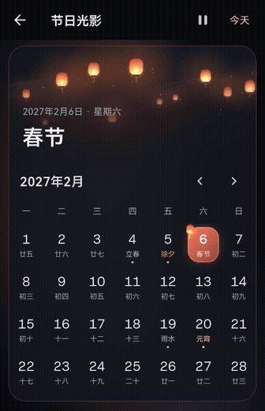 | 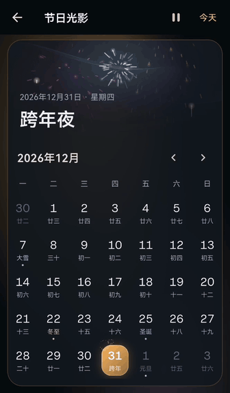 | 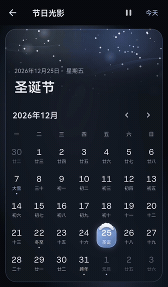 |

|  |  |  |  |
| --- | --- | --- | --- |
| 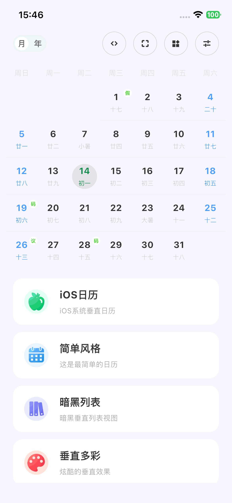 | 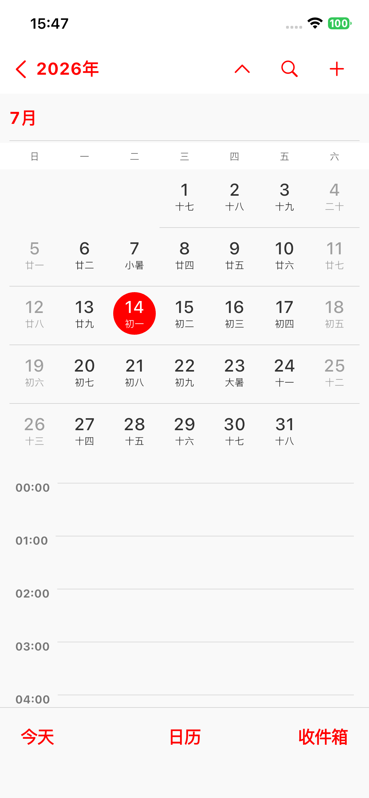 | 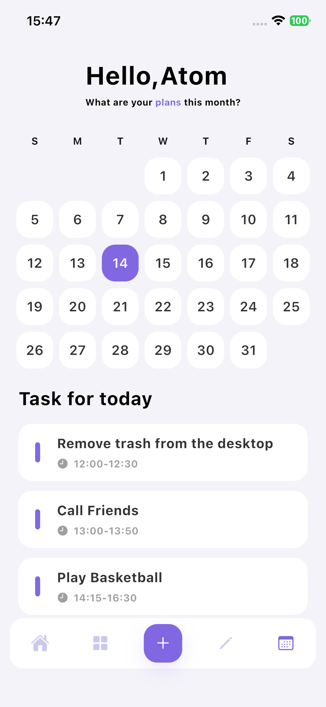 | 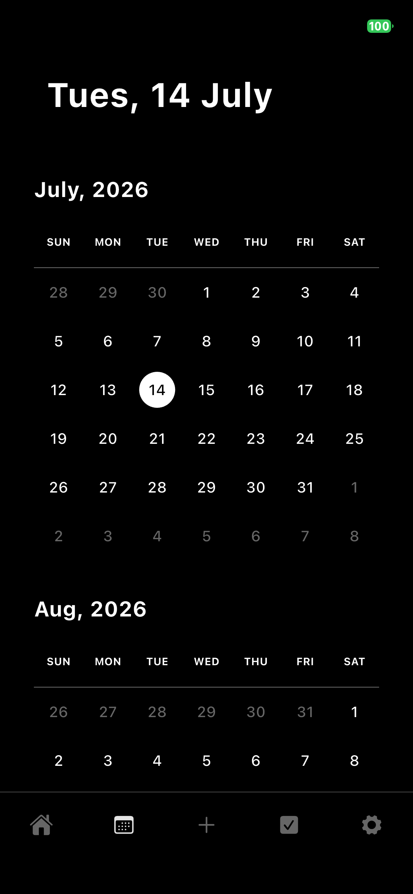 |
| 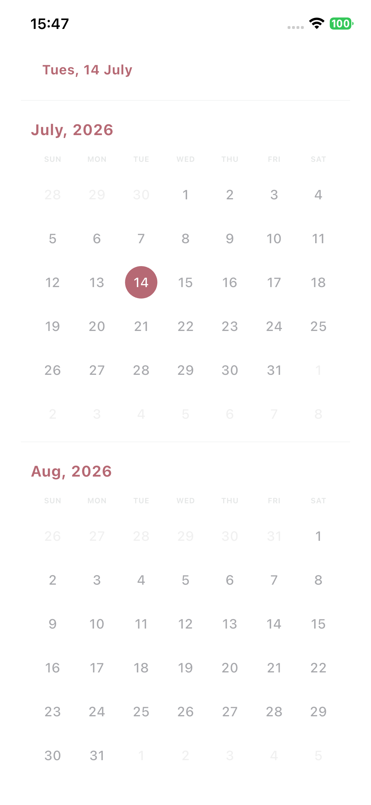 | 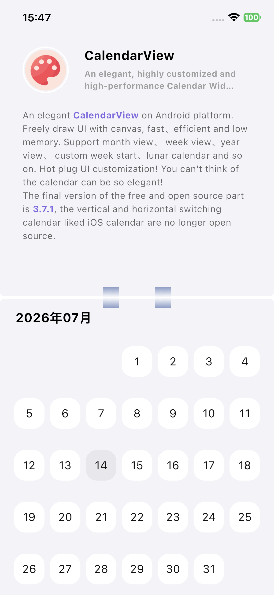 | 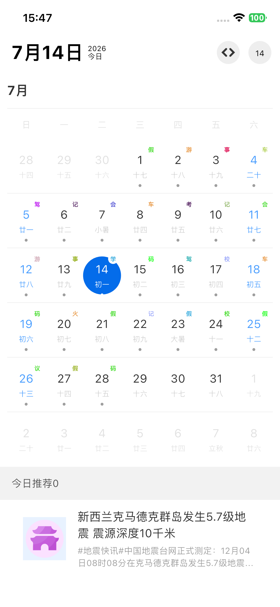 | 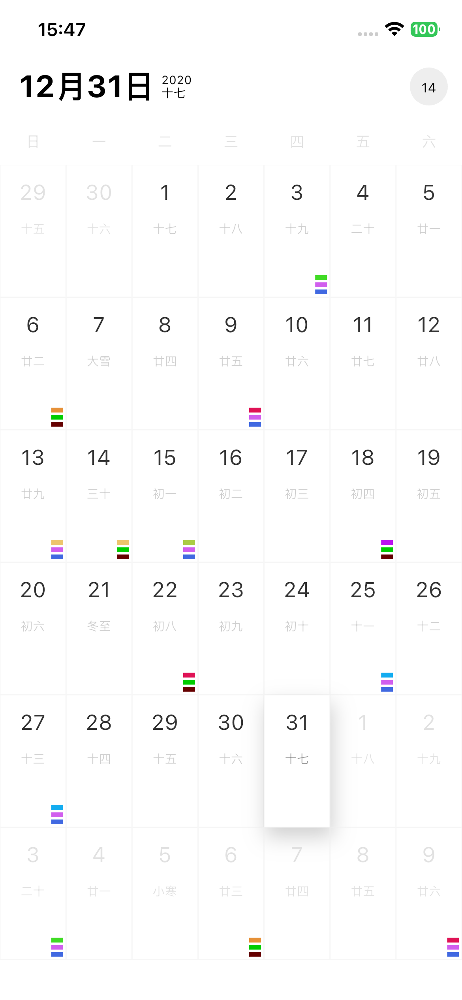 |
| 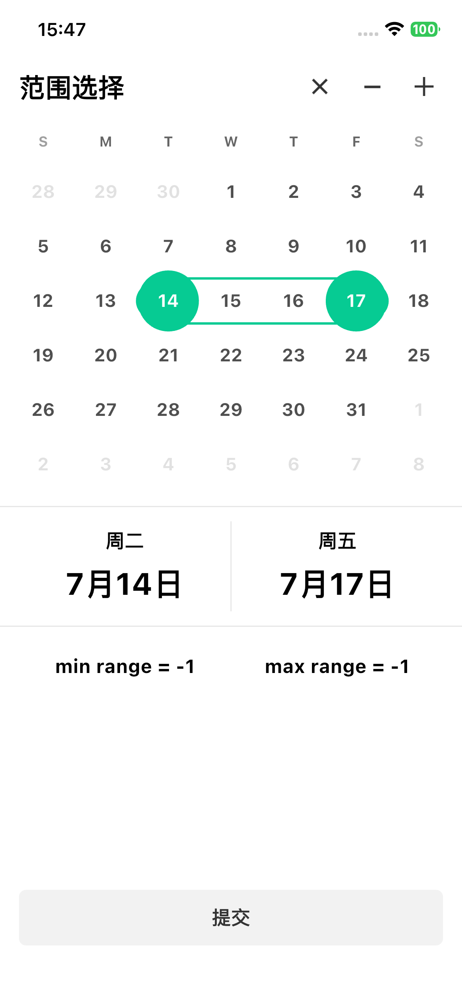 | 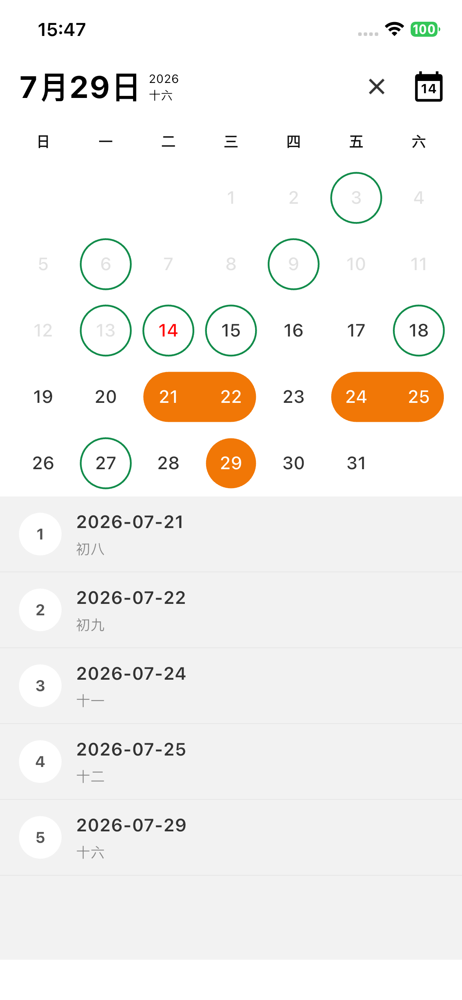 | 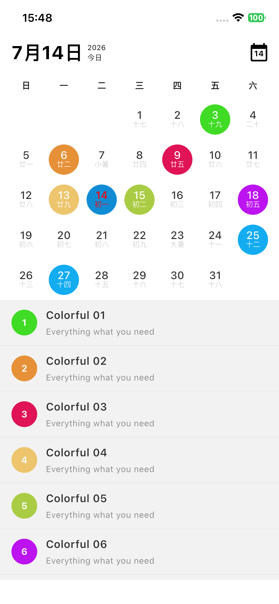 | 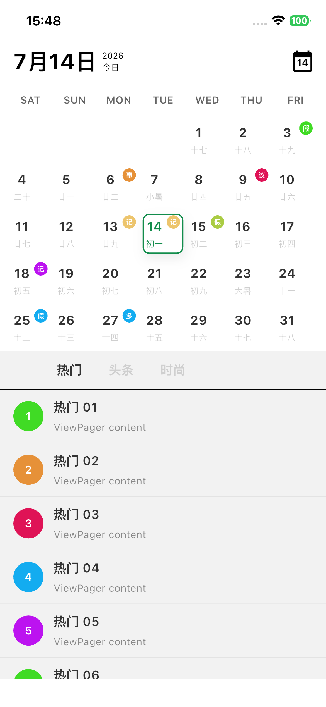 |
| 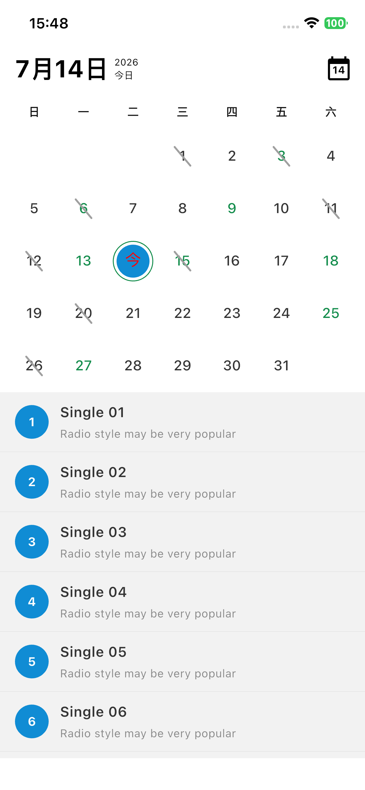 | 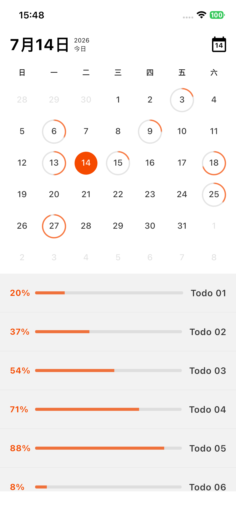 | 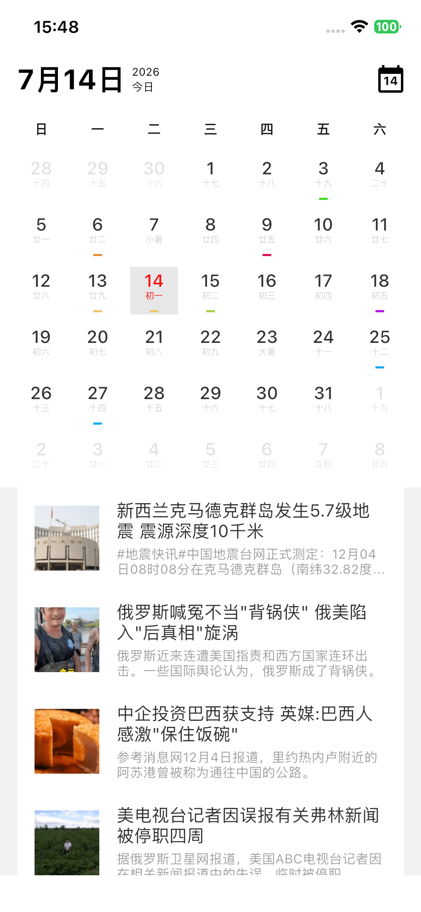 | 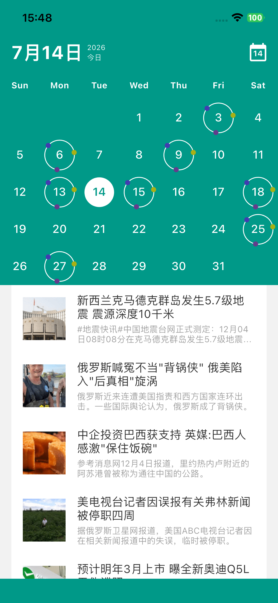 |

## 导入

```dart
import 'package:calendarview_flutter/calendarview_flutter.dart';
```

## 最小使用

可以用 `flutter run -t example/main.dart` 运行[最小示例](example/main.dart)，体验滑动切换月份和点击选择日期。

```dart
final controller = CalendarController(focusedDay: DateTime.now());

CalendarView(
  controller: controller,
  pageOrientation: CalendarPageOrientation.horizontal,
  onDaySelected: (day) {
    controller.selectDay(day);
  },
)
```

## CalendarController

构造参数：

| 参数 | 类型 | 说明 |
| --- | --- | --- |
| `focusedDay` | `DateTime?` | 当前聚焦日期，默认今天 |
| `minDate` | `DateTime?` | 可显示/可选择的最小日期 |
| `maxDate` | `DateTime?` | 可显示/可选择的最大日期 |
| `minSelectRange` | `int` | 范围选择最小天数，`-1` 表示不限制 |
| `maxSelectRange` | `int` | 范围选择最大天数，`-1` 表示不限制 |
| `maxMultiSelectSize` | `int` | 多选最大数量，`-1` 表示不限制 |
| `markers` | `Map<DateTime, List<CalendarMarker>>` | 日期标记数据 |
| `disabledDates` | `Set<DateTime>` | 固定禁用日期 |
| `disabledDatePredicate` | `CalendarDatePredicate?` | 动态禁用日期判断 |

状态读取：

| API | 说明 |
| --- | --- |
| `focusedDay` | 当前聚焦日期 |
| `displayMode` | 当前月/周模式 |
| `selectionMode` | 当前单选/范围/多选模式 |
| `firstWeekday` | 周起始日 |
| `selection` | 完整选择状态 |
| `rangeSelection` | 范围选择起止值 |
| `selectedRangeDates` | 已完成范围内所有日期 |
| `selectedMultiDates` | 多选日期列表，已排序 |
| `markers` | 当前标记数据 |
| `monthViewShowMode` | 月视图显示模式 |
| `onlyCurrentMonth` | 是否只显示当前月日期 |
| `interceptBlocked` | 是否启用内置演示禁用日期 |
| `minSelectRange` / `maxSelectRange` | 范围选择天数限制 |
| `maxMultiSelectSize` | 多选数量限制 |
| `minDate` / `maxDate` | 日期边界 |
| `calendarRange` | `CalendarBounds(min, max)` |
| `rangeDescription` | 日期边界描述文本 |

配置方法：

| API | 说明 |
| --- | --- |
| `setCalendarRange({minDate, maxDate, clampFocusedDay, adjustSelection})` | 设置日期边界 |
| `setRange(minYear, minMonth, minDay, maxYear, maxMonth, maxDay)` | 原 Android 风格的日期边界设置 |
| `setRangeSelectionLimits({minRange, maxRange})` | 设置范围选择天数限制 |
| `setMaxMultiSelectSize(maxSize)` | 设置多选数量上限 |
| `setDisplayMode(mode)` | 设置月/周模式 |
| `toggleDisplayMode()` | 切换月/周模式 |
| `setWeekStart(weekday)` | 设置周起始日，如 `DateTime.sunday` |
| `setOnlyCurrentMonth(value)` | 设置是否只显示当前月 |
| `setMonthViewShowMode(mode)` | 设置月视图显示模式 |
| `setInterceptBlocked(value)` | 开关内置演示禁用日期 |
| `setDisabledDatePredicate(predicate)` | 设置动态禁用规则 |
| `setSelectionMode(mode)` | 设置选择模式 |
| `setMarkers(markers)` | 替换日期标记 |

跳转与选择：

| API | 说明 |
| --- | --- |
| `jumpToDay(day)` | 跳到指定日期 |
| `jumpToMonth(month)` | 跳到指定月份 |
| `nextPage()` | 下一页 |
| `previousPage()` | 上一页 |
| `selectDay(day)` | 选择日期，返回是否成功 |
| `clearSelection()` | 清空当前模式下的选择 |
| `isDisabled(day)` | 日期是否不可选 |
| `isSelected(day)` | 日期是否选中 |
| `isRangeStart(day)` | 是否范围开始日期 |
| `isRangeEnd(day)` | 是否范围结束日期 |
| `isMultiSelectOutOfSize(day)` | 多选是否超出数量 |
| `rangeSelectionLimitViolation(day)` | 范围选择是否违反天数限制 |
| `canSelectRangeEnd(day)` | 是否可作为范围结束日期 |
| `canNavigateToPreviousPage()` | 是否能向前翻页 |
| `canNavigateToNextPage()` | 是否能向后翻页 |
| `resolvedPageAnchorForRelative(relative)` | 获取相对页锚点日期 |
| `canShowMonth(month)` | 月份是否在可显示范围内 |
| `canShowWeek(anchorDay)` | 周是否在可显示范围内 |

## 选择模式

单选：

```dart
controller
  ..setSelectionMode(CalendarSelectionMode.single)
  ..selectDay(DateTime(2026, 7, 14));
```

范围选择：

```dart
controller
  ..setSelectionMode(CalendarSelectionMode.range)
  ..setRangeSelectionLimits(minRange: 2, maxRange: 14);

CalendarView(
  controller: controller,
  pageOrientation: CalendarPageOrientation.horizontal,
  onDaySelected: (day) => controller.selectDay(day),
  onRangeSelected: (range) {
    final start = range.start;
    final end = range.end;
  },
  onSelectOutOfRange: (day, violation) {},
)
```

多选：

```dart
controller
  ..setSelectionMode(CalendarSelectionMode.multi)
  ..setMaxMultiSelectSize(5);

CalendarView(
  controller: controller,
  pageOrientation: CalendarPageOrientation.horizontal,
  onDaySelected: (day) => controller.selectDay(day),
  onMultiSelected: (day, selectedSize, maxSize) {},
  onMultiSelectOutOfSize: (day, maxSize) {},
)
```

## CalendarView

核心月/周日历视图。

| 参数 | 类型 | 说明 |
| --- | --- | --- |
| `controller` | `CalendarController` | 日历状态控制器 |
| `onDaySelected` | `ValueChanged<DateTime>` | 日期点击回调 |
| `pageOrientation` | `CalendarPageOrientation` | 横向或纵向分页 |
| `componentBuilder` | `CalendarComponentBuilder?` | 自定义日历 UI |
| `onPageChanged` | `ValueChanged<DateTime>?` | 页面变化回调 |
| `onDisplayedHeightChanged` | `ValueChanged<double>?` | 显示高度变化回调 |
| `collapsePreviewProgress` | `double?` | 折叠预览进度 |
| `previewExpandFromWeek` | `bool` | 周视图拖拽展开预览 |
| `monthBodyHeightOverride` | `double?` | 月主体高度覆盖 |
| `calendarHeight` | `double` | 单行高度 |
| `weekBarHeight` | `double` | 星期栏高度 |
| `monthHeaderHeight` | `double` | 月份头高度 |
| `handleDaySelection` | `bool` | 由视图内部调用 `selectDay` |
| `onRangeSelected` | `CalendarRangeSelectedCallback?` | 范围选择成功回调 |
| `onSelectOutOfRange` | `CalendarRangeLimitViolationCallback?` | 范围选择限制回调 |
| `onMultiSelected` | `CalendarMultiSelectedCallback?` | 多选成功回调 |
| `onMultiSelectOutOfSize` | `CalendarMultiSelectOutOfSizeCallback?` | 多选超限回调 |

## CalendarInteractiveController

控制可展开、折叠、全屏的日历布局。

状态：

| API | 说明 |
| --- | --- |
| `pageOrientation` | 当前分页方向 |
| `displayMode` | 当前月/周模式 |
| `collapseProgress` | 折叠进度 |
| `isFullScreenExpanded` | 是否全屏展开 |
| `isCollapsed` / `isExpanded` | 是否折叠/展开 |

方法：

| API | 说明 |
| --- | --- |
| `setPageOrientation(orientation)` | 设置分页方向 |
| `togglePageOrientation()` | 切换分页方向 |
| `expand()` | 展开日历 |
| `collapse()` / `shrink()` | 收起日历 |
| `toggleFullScreen()` | 切换全屏 |

## CalendarInteractiveView

日历 + 内容列表联动视图。

| 参数 | 说明 |
| --- | --- |
| `controller` | 日历控制器 |
| `onDaySelected` | 日期点击回调 |
| `contentBuilder` | 内容区构建器，接收 `ScrollController` 和 `ScrollPhysics` |
| `onFocusedDayChanged` | 聚焦日期变化 |
| `interactionController` | 交互控制器 |
| `pageOrientation` | 分页方向覆盖 |
| `yearMode` | 年视图模式下禁用部分交互 |
| `calendarHeight` / `weekBarHeight` / `monthHeaderHeight` | 尺寸设置 |
| `componentBuilder` | 自定义日历 UI |
| `contentVerticalDragLocked` | 锁定内容区分发给日历的纵向拖拽 |

## CalendarMonthYearController

控制年视图浮层。

| API | 说明 |
| --- | --- |
| `isYearMode` | 是否在年视图 |
| `visibleYear` | 当前年视图年份 |
| `showYearMode()` | 显示年视图 |
| `hideYearMode()` | 隐藏年视图 |
| `setYearMode(value)` | 设置年视图状态 |
| `toggleYearMode()` | 切换年视图状态 |

## CalendarMonthYearView

在 `CalendarInteractiveView` 之上增加年视图。

| 参数 | 说明 |
| --- | --- |
| `controller` | 日历控制器 |
| `onDaySelected` | 日期点击回调 |
| `contentBuilder` | 内容区构建器 |
| `onFocusedDayChanged` | 聚焦日期变化 |
| `onYearModeChanged` | 年视图状态变化 |
| `onMonthSelected` | 年视图中选择月份 |
| `interactionController` | 交互控制器 |
| `monthYearController` | 年视图控制器 |
| `pageOrientation` | 分页方向 |
| `calendarHeight` / `weekBarHeight` / `monthHeaderHeight` | 尺寸设置 |
| `componentBuilder` | 自定义日历 UI |

## CalendarMonthListView

按月份连续滚动的列表视图。

| 参数 | 说明 |
| --- | --- |
| `controller` | 日历控制器 |
| `onDaySelected` | 日期点击回调 |
| `calendarHeight` | 单行高度 |
| `weekBarHeight` | 星期栏高度 |
| `componentBuilder` | 自定义日历 UI |
| `onFocusedMonthChanged` | 滚动时，列表顶部进入新月份后回调一次，参数为该月第一天 |

## CalendarYearModeStyle

年视图样式配置。

| 字段 | 说明 |
| --- | --- |
| `backgroundColor` | 背景色 |
| `primaryColor` | 主文本色 |
| `dayColor` | 月份预览日期颜色 |
| `outsideMonthDayColor` | 月份外日期颜色 |
| `selectedColor` | 选中背景色 |
| `selectedTextColor` | 选中文本色 |
| `dividerColor` | 分割线颜色 |
| `inactiveBorderColor` | 非激活边框色 |
| `disabledMonthBackgroundColor` | 禁用月份背景色 |
| `disabledMonthBorderColor` | 禁用月份边框色 |
| `disabledMonthTextColor` | 禁用月份标题色 |
| `disabledMonthDayColor` | 禁用月份日期色 |
| `disabledMonthOutsideDayColor` | 禁用月份外日期色 |
| `headerHeight` | 年视图头部高度 |
| `monthCardRadius` | 月份卡片圆角 |
| `monthNames` | 月份名称 |

内置值：`CalendarYearModeStyle.dark`、`CalendarYearModeStyle.vertical`。

## CalendarYearModeLayout

为自定义页面增加年视图覆盖层。

| 参数 | 说明 |
| --- | --- |
| `controller` | `CalendarMonthYearController` |
| `selectedDate` | 当前选中日期 |
| `minDate` / `maxDate` | 可选月份范围 |
| `style` | 年视图样式 |
| `onMonthSelected` | 月份选择回调 |
| `child` | 页面内容 |

## CalendarComponentBuilder

日历样式扩展协议。库层只提供协议，不内置 demo 样式。

需要实现：

| API | 说明 |
| --- | --- |
| `orderedWeekLabels(firstWeekday)` | 按周起始返回星期文本 |
| `buildWeekBarCell(context, data)` | 构建星期栏单元 |
| `buildDayCell(context, data)` | 构建日期单元 |

可覆盖：

| API | 说明 |
| --- | --- |
| `contentPadding` | 日历主体左右内边距 |
| `weekBarBackgroundColor` | 星期栏背景色 |
| `buildMonthHeader(context, month, height)` | 月份头 |
| `buildWeekBar(context, data)` | 完整星期栏 |

示例：

```dart
class MyCalendarBuilder extends CalendarComponentBuilder {
  const MyCalendarBuilder();

  @override
  List<String> orderedWeekLabels(int firstWeekday) {
    return calendarOrderedWeekLabels(
      const ['日', '一', '二', '三', '四', '五', '六'],
      firstWeekday,
    );
  }

  @override
  Widget buildWeekBarCell(BuildContext context, CalendarWeekBarCellData data) {
    return Text(data.label);
  }

  @override
  Widget buildDayCell(BuildContext context, CalendarDayCellData data) {
    return Center(child: Text('${data.date.day}'));
  }
}
```

辅助 API：

| API | 说明 |
| --- | --- |
| `DefaultCalendarComponentBuilder` | 默认基础样式 |
| `calendarOrderedWeekLabels(labels, firstWeekday)` | 根据周起始重排星期文本 |
| `kCalendarHorizontalPadding` | 默认水平边距 |

## Canvas 日历绘制

内置月视图和周视图的月份标题、星期栏和日期网格都使用 Canvas。日期网格按原绘制顺序合并相邻的纯 `CustomPaint` 单元格，并缓存日期数据和画笔。带子组件、前景画笔、自定义语义或 Key 的日期格，以及返回其他 Widget 的日期格，保留原位布局和交互，周围的日期格继续合并绘制。

仍可通过 `CalendarComponentBuilder` 的原有方法自定义日期格、月份标题和星期栏。测试可通过 `find.semantics.byLabel` 查询 Canvas 绘制的月份、星期和日期，也可以按网格坐标点击日期。

## 数据模型与回调

| API | 说明 |
| --- | --- |
| `CalendarSelectionMode.single/range/multi` | 选择模式 |
| `CalendarDisplayMode.month/week` | 显示模式 |
| `CalendarPageOrientation.horizontal/vertical` | 分页方向 |
| `MonthViewShowMode.allMonth/onlyCurrentMonth/fitMonth` | 月视图显示模式 |
| `CalendarRangeLimitViolation.belowMinRange/aboveMaxRange` | 范围选择限制类型 |
| `CalendarBounds(min, max)` | 日期边界 |
| `CalendarMarker(label, color, data)` | 日期标记，`data` 为可选的业务对象 |
| `CalendarMarkerIndex(markersByDate)` | 已按日期建立索引的标记，只读且无需复制 |
| `LunarMetadata(lunarText, solarTerm)` | 农历/节气文本 |
| `DateRangeValue(start, end)` | 范围选择值 |
| `CalendarSelectionState(single, range, multi)` | 完整选择状态 |
| `CalendarDatePredicate` | 日期判断函数 |
| `CalendarRangeSelectedCallback` | 范围选择回调 |
| `CalendarRangeLimitViolationCallback` | 范围选择限制回调 |
| `CalendarMultiSelectedCallback` | 多选回调 |
| `CalendarMultiSelectOutOfSizeCallback` | 多选超限回调 |

### 日期标记与大数据量

`CalendarMarker.data` 的类型是 `Object?`，默认值为 `null`。自定义日期格可以从 `CalendarDayCellData.markers` 读取原业务对象。已有构造和继承用法继续有效。如果直接 `implements CalendarMarker`，请实现 `Object? get data`，默认可以返回 `null`。

```dart
final controller = CalendarController();
final day = DateTime(2026, 11, 19);
final meeting = (id: 'meeting-42', title: '项目会议');
final markersByDate = <DateTime, List<CalendarMarker>>{
  day: [
    CalendarMarker(label: meeting.title, color: Colors.blue, data: meeting),
    const CalendarMarker(label: '待办', color: Colors.orange),
  ],
};
```

1. **大数据快速设置（推荐）**。大数据集优先使用 `CalendarMarkerIndex`，日期键使用 `DateTime(year, month, day)`。日历借用原 Map 和列表的只读视图，提交时无需遍历日期键，渲染时按可见日期查找。提交后保持原 Map 和列表内容稳定。

   ```dart
   controller.setMarkers(CalendarMarkerIndex(markersByDate));
   ```

2. **普通设置**。适合标记较少或需要自动归一化日期键的场景。直接传 Map，控制器会同步归一化日期键并建立独立的日期映射。在原生平台，已归一化的大 Map 可走批量复制路径。

   ```dart
   controller.setMarkers(markersByDate);
   ```

3. **创建控制器时传入**。`markers` 参数接受普通 Map 和 `CalendarMarkerIndex`。

   ```dart
   final preloadedController = CalendarController(
     markers: CalendarMarkerIndex(markersByDate),
   );
   ```

4. **读取业务对象**。自定义日期格可以从 `CalendarDayCellData` 读取标记。点击日期后，可以用回调提供的日期查询当天的标记列表。

   ```dart
   // 在 buildDayCell 中，cell 是 CalendarDayCellData。
   final payload = cell.primaryMarker?.data;

   // 在 onDaySelected 中，用选中的日期查询标记。
   final dayMarkers = controller.markers[day] ?? const <CalendarMarker>[];
   ```

5. **更新或清空**。`setMarkers` 每次替换整份标记。使用快速路径更新时，将变更后的列表放入新的 Map，再传入新索引。

   ```dart
   final nextMarkersByDate = <DateTime, List<CalendarMarker>>{
     ...markersByDate,
     day: [const CalendarMarker(label: '已完成', color: Colors.green)],
   };
   controller.setMarkers(CalendarMarkerIndex(nextMarkersByDate));
   ```

   清空全部日期标记。

   ```dart
   controller.setMarkers({});
   ```

Canvas 无障碍描述最多读取前 8 条标记并附上剩余数量。自定义构建器可以访问完整列表，普通 Map 提供只读快照，`CalendarMarkerIndex` 提供只读视图。

## 年概览弹层

```dart
await showYearOverviewSheet(
  context,
  year: 2026,
  onMonthSelected: (month) {
    controller.jumpToMonth(month);
  },
);
```

## 致谢

感谢 [huanghaibin-dev/CalendarView](https://github.com/huanghaibin-dev/CalendarView) 作者提供 Android 版本源码参考。

## 再次感谢支持

如果这个库节省了你的开发时间，欢迎支持作者持续维护。

| 支付宝 | 微信 |
| --- | --- |
|  |  |
